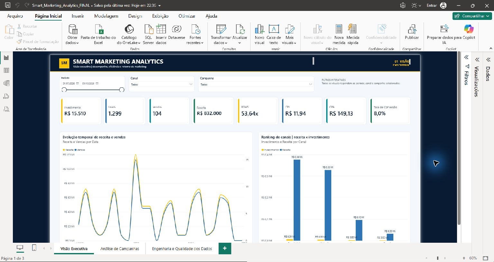
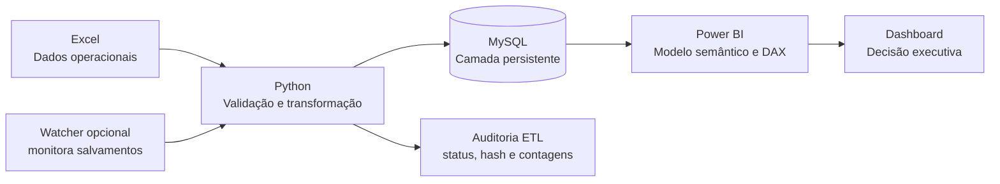
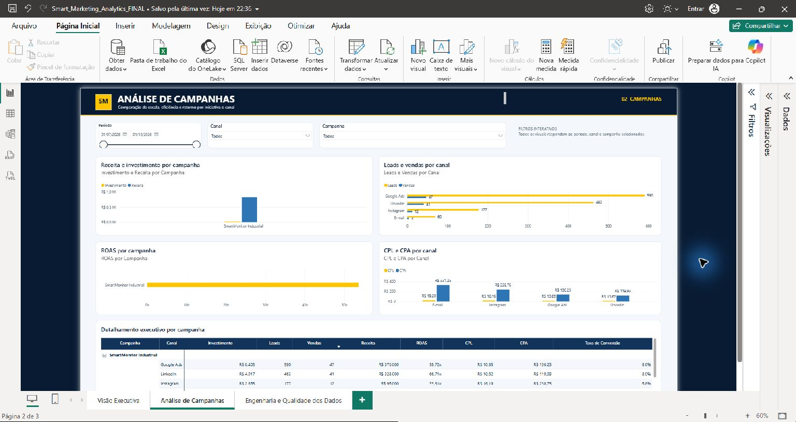
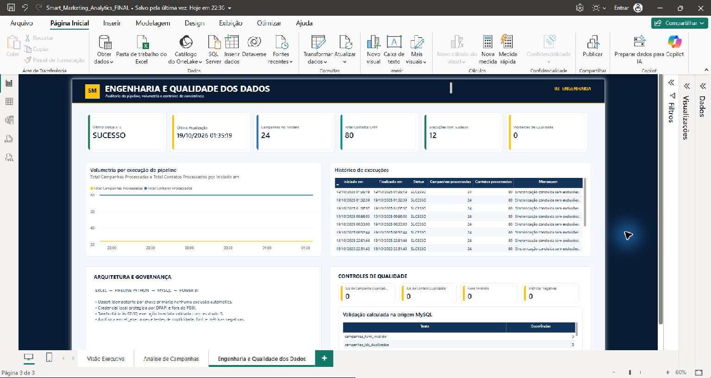

# Smart Marketing Analytics

Pipeline de dados e dashboard executivo para acompanhar investimento, geração de
leads, vendas, receita e eficiência de campanhas de marketing. O projeto demonstra
uma solução ponta a ponta: Excel como entrada operacional, validação e carga em
Python, persistência transacional no MySQL e análise interativa no Power BI.

> **Portfólio independente.** Todos os dados deste repositório são fictícios e não
> representam clientes, colaboradores ou resultados ou de qualquer
> outra empresa.



## Objetivo

Transformar uma planilha operacional em uma camada analítica confiável, auditável e
pronta para tomada de decisão. A solução foi desenhada para:

- validar esquema, tipos, chaves e coerência do funil antes da carga;
- atualizar registros por `UPSERT`, sem duplicar nem excluir dados;
- registrar cada execução do ETL para auditoria;
- disponibilizar KPIs e análises dinâmicas no Power BI;
- permitir execução demonstrativa sem MySQL por meio de SQLite temporário;
- manter credenciais fora do código e dos artefatos versionados.

## Arquitetura



O Excel contém duas granularidades independentes:

- `Campanhas`: métricas agregadas por campanha e data;
- `Leads`: contatos fictícios do CRM.

Essas tabelas não são relacionadas diretamente, pois um total agregado de leads de
campanha não representa necessariamente a mesma população da amostra de contatos.

## Dashboard

O relatório possui três páginas:

1. **Visão Executiva** — KPIs, evolução temporal, comparação por canal e filtros.
2. **Análise de Campanhas** — ranking, eficiência, custos e tabela detalhada.
3. **Engenharia e Qualidade dos Dados** — arquitetura, última carga, auditoria e testes de qualidade.

### KPIs

| Indicador | Definição |
|---|---|
| Investimento | Soma do valor investido nas campanhas |
| Leads | Soma dos leads agregados das campanhas |
| Vendas | Soma das vendas atribuídas |
| Receita | Soma da receita atribuída |
| ROAS | Receita ÷ investimento |
| CPL | Investimento ÷ leads |
| CPA | Investimento ÷ vendas |
| Taxa de conversão | Vendas ÷ leads |
| CTR | Cliques ÷ impressões |
| CPC | Investimento ÷ cliques |

A divisão por zero resulta em valor nulo, evitando indicadores enganosos.

### Capturas

| Página | Prévia |
|---|---|
| Visão Executiva |  |
| Análise de Campanhas |  |
| Engenharia e Qualidade |  |

## Tecnologias

- Python 3.11 ou superior;
- MySQL 8.0 ou superior;
- Microsoft Power BI Desktop;
- Excel (`.xlsx`);
- SQLite para testes locais isolados;
- `mysql-connector-python` para integração com MySQL;
- `unittest` para testes automatizados.

## Estrutura do repositório

```text
smart-marketing-analytics-github/
├── data/
│   └── Smart_Marketing_Analytics_DEMO.xlsx
├── docs/
│   ├── POWER_BI_REFRESH.md
│   ├── SECURITY_AUDIT.md
│   └── SECURITY_CHECKLIST.md
├── images/
│   ├── analise-campanhas.jpg
│   ├── engenharia-qualidade.jpg
│   └── visao-executiva.jpg
├── powerbi/
│   └── Smart_Marketing_Analytics_PORTFOLIO.pbix
├── sql/
│   ├── schema.sql
│   └── validation_queries.sql
├── src/smart_marketing/
│   ├── config.py
│   ├── excel_reader.py
│   ├── exporter.py
│   ├── models.py
│   ├── pipeline.py
│   ├── repository.py
│   ├── validation.py
│   └── watcher.py
├── tests/
│   └── test_pipeline.py
├── .env.example
├── .gitignore
├── LICENSE
├── pyproject.toml
├── requirements.txt
└── README.md
```

O projeto é distribuído sob a licença MIT.

## Dados demonstrativos

A planilha pública foi reconstruída com conteúdo sintético e contém:

- 24 campanhas;
- 80 contatos CRM fictícios;
- R$ 15.510,00 de investimento;
- 1.299 leads agregados;
- 104 vendas;
- R$ 832.000,00 de receita.

Os nomes de empresas seguem o padrão `Empresa Demonstração NNN`. Nenhum log,
histórico operacional, credencial, arquivo DPAPI ou dado pessoal foi incluído.

## Execução rápida sem MySQL

No PowerShell, a partir da raiz do repositório:

```powershell
python -m venv .venv
.\.venv\Scripts\Activate.ps1
python -m pip install --upgrade pip
pip install -r requirements.txt
$env:PYTHONPATH = "$PWD\src"
python -m smart_marketing.pipeline `
  --workbook data\Smart_Marketing_Analytics_DEMO.xlsx `
  --backend sqlite `
  --sqlite-path runtime\demo.sqlite3
```

A execução cria apenas artefatos locais ignorados pelo Git. Execute o comando duas
vezes para observar a segunda carga como atualização, sem novas inserções.

## Execução com MySQL

### 1. Criar o esquema

O script é idempotente e não contém `DROP`, `TRUNCATE` ou exclusão de registros:

```powershell
mysql -u root -p < sql\schema.sql
```

Para ambientes corporativos, prefira um usuário exclusivo com permissões mínimas
sobre o banco `smart_marketing`.

### 2. Configurar variáveis de ambiente

```powershell
$env:SMART_MARKETING_MYSQL_HOST = "127.0.0.1"
$env:SMART_MARKETING_MYSQL_PORT = "3306"
$env:SMART_MARKETING_MYSQL_DATABASE = "smart_marketing"
$env:SMART_MARKETING_MYSQL_USER = "seu_usuario_local"
$env:SMART_MARKETING_MYSQL_PASSWORD = "defina_localmente"
```

Não grave a senha no código, no README, no PBIX ou em arquivo versionado. O arquivo
`.env.example` documenta apenas os nomes das variáveis.

### 3. Executar o pipeline

```powershell
$env:PYTHONPATH = "$PWD\src"
python -m smart_marketing.pipeline `
  --workbook data\Smart_Marketing_Analytics_DEMO.xlsx `
  --backend mysql
```

O pipeline valida o Excel antes de abrir a transação. Em seguida, registra a
execução, aplica `UPSERT`, verifica duplicidades e confirma a transação. Qualquer
falha causa rollback; registros ausentes no Excel são reportados, mas não apagados.

### Monitor opcional de salvamentos

Com as mesmas variáveis definidas:

```powershell
$env:PYTHONPATH = "$PWD\src"
python -m smart_marketing.watcher `
  --workbook data\Smart_Marketing_Analytics_DEMO.xlsx `
  --run-on-start
```

O monitor aguarda o XLSX ficar estável e legível, evita instâncias simultâneas e
continua ativo após uma falha. Para produção, use o mecanismo de credenciais e de
inicialização aprovado pela política da organização; nenhum segredo persistente é
fornecido neste repositório.

## Testes

```powershell
$env:PYTHONPATH = "$PWD\src"
python -m unittest discover -s tests -v
```

A suíte verifica:

- 24 campanhas e 80 contatos com IDs únicos;
- totais de referência do dataset demonstrativo;
- rejeição de campanha duplicada;
- duas cargas SQLite consecutivas;
- 24 inserções na primeira carga e 24 atualizações na segunda;
- nenhuma exclusão e nenhuma duplicação;
- duas entradas de auditoria ETL.

As consultas de conferência do MySQL estão em `sql/validation_queries.sql`.

## Power BI

O PBIX público foi copiado somente após uma busca local por credenciais, tokens,
caminhos pessoais e identificadores. Ele utiliza o banco `smart_marketing` em
`127.0.0.1:3306`, mas não carrega usuário ou senha em texto legível.

Para atualizar localmente:

1. crie e carregue o banco com os dados demonstrativos;
2. abra `powerbi/Smart_Marketing_Analytics_PORTFOLIO.pbix`;
3. em **Arquivo > Opções e configurações > Configurações da fonte de dados**, informe suas credenciais locais;
4. selecione **Página Inicial > Atualizar**.

Se o servidor ou o banco tiver outro nome, altere a fonte de dados antes da
atualização. Consulte [Atualização do Power BI](docs/POWER_BI_REFRESH.md) para as
limitações do Desktop e os requisitos do Service.

## Segurança e privacidade

- credenciais são lidas somente de variáveis de ambiente;
- logs, `.env`, bancos locais, DPAPI e caches estão no `.gitignore`;
- o dataset é sintético;
- o SQL não contém operações destrutivas;
- o PBIX foi submetido a busca de padrões sensíveis antes da cópia;
- nenhuma publicação ou upload foi realizado.

Revise [o checklist de segurança](docs/SECURITY_CHECKLIST.md) antes do primeiro
commit. O [relatório da auditoria local](docs/SECURITY_AUDIT.md) registra as
verificações já executadas. Use uma ferramenta de secret scanning também sobre o
histórico Git.

## Licença

Distribuído sob a [licença MIT](LICENSE).
